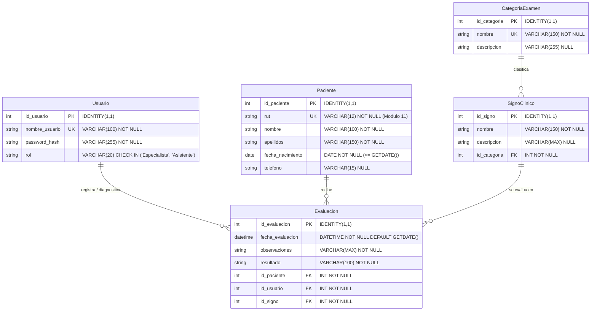

# Informe Técnico de Arquitectura, Seguridad e Implementación
## Sistema Integral de Evaluaciones Clínicas (ClinicaApi)
### Asignatura: Lenguaje de Programación Web II | Evaluación UT2

---

- **Estudiante:** Ignacio Espinoza
- **Carrera / Especialidad:** Ingeniería / Técnico en Informática
- **Docente:** Enso Guidotti
- **Fecha de Entrega:** Octubre 2026
- **Repositorio:** Monorepo `ClinicaApi-main` (.NET 10 Minimal APIs + React 19 / TypeScript)
- **Base de Datos:** Microsoft SQL Server (`EvaluacionesClinicasDB`)

---

## 1. Resumen Ejecutivo y Objetivos del Proyecto

El presente proyecto corresponde al desarrollo e integración fullstack del **Sistema de Gestión de Evaluaciones Clínicas**, diseñado para soportar las operaciones de diagnóstico médico, seguimiento kinesiológico y neurológico de pacientes en un entorno hospitalario ambulatorio.

El sistema fue concebido como una solución desacoplada y modular bajo la estructura de un **Monorepo**, compuesta por:
1. **Capa Backend RESTful:** Desarrollada con **.NET 10 Minimal APIs**, Entity Framework Core 10, SQL Server, autenticación con tokens **JWT**, control de tasa (*Rate Limiting*), cabeceras de seguridad HTTP, middlewares de auditoría y manejo global de excepciones en formato estructurado RFC 7807 (*ProblemDetails*).
2. **Capa Frontend SPA:** Desarrollada con **React 19**, **Vite** y **TypeScript**, implementando una arquitectura por capas (*types*, *services*, *context*, *components*, *views*, *test*), validación estricta de formularios mediante **React Hook Form** y **Zod**, gestión centralizada de peticiones con **Axios e interceptores**, diseño responsivo *Mobile-First* y certificación de accesibilidad web bajo los criterios de éxito de **WCAG 2.2 Nivel AA**.
3. **Capa de Base de Datos Relacional:** Modelada y normalizada en **Microsoft SQL Server**, garantizando integridad referencial, índices de rendimiento y datos semilla verificados.

### Objetivos Técnicos Alcanzados:
- **Consumo Integral de APIs:** Conexión y consumo del 100% de los endpoints derivados del modelo relacional: Pacientes, Categorías de Examen, Signos Clínicos, Evaluaciones Clínicas y Gestión de Usuarios.
- **Validación Algorítmica de RUT Chileno:** Validación simétrica en cliente y servidor del formato y dígito verificador del RUT mediante el algoritmo **Módulo 11**.
- **Control de Acceso de Dos Dimensiones (RBAC & BFLA):**
  - **Dimensión Clínica (Rol):** `Especialista` (Doctor facultado para crear y editar evaluaciones) vs `Asistente` (Personal de apoyo clínico).
  - **Dimensión Administrativa (Credencial Admin):** Otorgada a `dr_admin` y `asistente_admin`. **Únicamente estos dos usuarios con credencial de administrador pueden crear y eliminar a otros doctores y asistentes.**
- **Mitigación Activa de Vulnerabilidades:** Tratamiento explícito de los riesgos del **OWASP API Security Top 10** (API1 a API10).
- **Cobertura de Pruebas Automatizadas:** 10 pruebas de integración en Backend (.NET xUnit) y 26 pruebas unitarias y de componentes en Frontend (Vitest + Testing Library), todas con resultado 100% aprobado.

---

## 2. Modelo de Base de Datos Relacional (`EvaluacionesClinicasDB`)

El modelo de datos se estructura en torno a la entidad central **Evaluacion**, la cual vincula al **Paciente**, al profesional evaluador (**Usuario**) y la prueba diagnóstica aplicada (**SignoClinico**), organizada bajo una **CategoriaExamen**.

### 2.1 Diagrama Entidad-Relación (ERD)



---

### 2.2 Diccionario de Datos

#### Tabla: `Usuario`
Almacena los usuarios autorizados para interactuar con la plataforma médica.

| Columna | Tipo de Dato | Nulo | Restricciones | Descripción |
| :--- | :--- | :---: | :--- | :--- |
| `id_usuario` | `INT` | No | PK, `IDENTITY(1,1)` | Identificador secuencial único del usuario. |
| `nombre_usuario` | `VARCHAR(100)` | No | `UNIQUE` | Nombre de cuenta alfanumérico para inicio de sesión. |
| `password_hash` | `VARCHAR(255)` | No | - | Hash criptográfico o hash seguro de la contraseña. |
| `rol` | `VARCHAR(20)` | No | `DEFAULT 'Asistente'`, `CHECK` | Rol clínico: `'Especialista'` o `'Asistente'`. |

#### Tabla: `Paciente`
Contiene la información de filiación de los pacientes evaluados en la institución.

| Columna | Tipo de Dato | Nulo | Restricciones | Descripción |
| :--- | :--- | :---: | :--- | :--- |
| `id_paciente` | `INT` | No | PK, `IDENTITY(1,1)` | Identificador secuencial único del paciente. |
| `rut` | `VARCHAR(12)` | No | `UNIQUE` | Cédula nacional de identidad validada con Módulo 11 (`XXXXXXXX-X`). |
| `nombre` | `VARCHAR(100)` | No | - | Nombres de pila del paciente. |
| `apellidos` | `VARCHAR(150)` | No | - | Apellido paterno y materno del paciente. |
| `fecha_nacimiento` | `DATE` | No | `CHECK (<= GETDATE())` | Fecha de nacimiento (no futura). |
| `telefono` | `VARCHAR(15)` | Sí | - | Teléfono de contacto en formato internacional/nacional. |

#### Tabla: `CategoriaExamen`
Catálogo de especialidades o agrupaciones clínicas de evaluación.

| Columna | Tipo de Dato | Nulo | Restricciones | Descripción |
| :--- | :--- | :---: | :--- | :--- |
| `id_categoria` | `INT` | No | PK, `IDENTITY(1,1)` | Identificador único de la categoría. |
| `nombre` | `VARCHAR(150)` | No | `UNIQUE` | Nombre descriptivo de la disciplina médica (ej: *Ciencias Neurológicas*). |
| `descripcion` | `VARCHAR(255)` | Sí | - | Resumen del alcance y aplicaciones de la categoría. |

#### Tabla: `SignoClinico`
Catálogo de pruebas físicas, maniobras exploratorias y signos médicos específicos.

| Columna | Tipo de Dato | Nulo | Restricciones | Descripción |
| :--- | :--- | :---: | :--- | :--- |
| `id_signo` | `INT` | No | PK, `IDENTITY(1,1)` | Identificador secuencial del signo clínico. |
| `nombre` | `VARCHAR(150)` | No | - | Nombre de la prueba (ej: *Prueba de Ataxia*, *Signo de Gowers*). |
| `descripcion` | `VARCHAR(MAX)` | Sí | - | Protocolo de ejecución y criterios de evaluación. |
| `id_categoria` | `INT` | No | FK -> `CategoriaExamen(id_categoria)` | Categoría a la que pertenece el signo. |

#### Tabla: `Evaluacion`
Registro central de los resultados diagnósticos obtenidos tras aplicar un signo clínico.

| Columna | Tipo de Dato | Nulo | Restricciones | Descripción |
| :--- | :--- | :---: | :--- | :--- |
| `id_evaluacion` | `INT` | No | PK, `IDENTITY(1,1)` | Identificador secuencial de la evaluación. |
| `fecha_evaluacion` | `DATETIME` | No | `DEFAULT GETDATE()` | Fecha y hora en que se practicó el examen. |
| `observaciones` | `VARCHAR(MAX)` | No | - | Notas clínicas, sintomatología observada y contexto. |
| `resultado` | `VARCHAR(100)` | No | - | Dictamen o diagnóstico resultante (ej: *Ataxia Positiva*). |
| `id_paciente` | `INT` | No | FK -> `Paciente(id_paciente)` | Paciente al cual se le realizó el examen. |
| `id_usuario` | `INT` | No | FK -> `Usuario(id_usuario)` | Profesional médico que ejecutó el diagnóstico. |
| `id_signo` | `INT` | No | FK -> `SignoClinico(id_signo)` | Prueba o signo clínico aplicado. |

---

### 2.3 Índices de Rendimiento Creados en `clinica.sql`

Para optimizar las consultas con filtros `JOIN` y agregaciones estadísticas en el Dashboard:
1. `IX_SignoClinico_Categoria` en `[dbo].[SignoClinico]([id_categoria] ASC)`
2. `IX_Evaluacion_Paciente` en `[dbo].[Evaluacion]([id_paciente] ASC)`
3. `IX_Evaluacion_Usuario` en `[dbo].[Evaluacion]([id_usuario] ASC)`
4. `IX_Evaluacion_Signo` en `[dbo].[Evaluacion]([id_signo] ASC)`

---

## 3. Arquitectura del Sistema y Monorepo

El monorepo separa responsabilidades de forma estricta, desacoplando la capa de transporte HTTP de las reglas de negocio y de los componentes de presentación.

```mermaid
flowchart LR
    subgraph Frontend["Frontend SPA (React 19 + TypeScript)"]
        UI["Vistas (Views) & Componentes Accesibles"]
        Hook["React Hook Form + Zod (Validación)"]
        State["AuthContext (JWT en sessionStorage)"]
        Client["Axios Interceptor (Bearer + Rate Limit)"]
        UI --> Hook
        UI --> State
        Hook --> Client
        State --> Client
    end

    subgraph Backend["Backend RESTful (.NET 10 Minimal APIs)"]
        Middlewares["Pipeline Middlewares: CORS, SecurityHeaders, RateLimiting, GlobalError"]
        AuthSvc["AuthService (Generación & Claims JWT)"]
        Endpoints["Minimal API Endpoints: Evaluaciones, Pacientes, Catálogos, Usuarios"]
        Repo["IEvaluacionRepository / DTOs"]
        EFCore["Entity Framework Core 10 (ClinicaDbContext)"]
        Middlewares --> Endpoints
        Endpoints --> AuthSvc
        Endpoints --> Repo
        Repo --> EFCore
    end

    subgraph Database["Base de Datos Relacional"]
        SQL["SQL Server: EvaluacionesClinicasDB"]
        EFCore --> SQL
    end

    Client -- "HTTPS / JSON Bearer" --> Middlewares
```



---

## 4. Matriz de Seguridad y Control de Acceso (BFLA & RBAC)

Uno de los requerimientos centrales del sistema fue resolver la vulnerabilidad **OWASP API5:2023 - Broken Function Level Authorization (BFLA)**. El sistema combina dos niveles de autorización ortogonales:

1. **Rol Clínico (`rol`):** Determina qué actos médicos puede realizar el profesional.
   - `Especialista`: Facultado para diagnosticar, crear, editar y eliminar evaluaciones médicas.
   - `Asistente`: Personal clínico de soporte; puede consultar evaluaciones y registrar pacientes y catálogos.
2. **Credencial Administrativa (`IsAdmin`):** Determina qué usuarios están facultados para la administración y gobierno de cuentas en el sistema.
   - Solo los usuarios que poseen credencial de Administrador (**Doctor Admin** `dr_admin` y **Asistente Admin** `asistente_admin`) pueden gestionar usuarios clínicos.

### 4.1 Matriz de Permisos Detallada

| Funcionalidad / Endpoint | Método | Doctor Admin (`dr_admin`) | Asistente Admin (`asistente_admin`) | Asistente Estándar (`asistente_01`) | Doctor Regular (No-Admin) |
| :--- | :---: | :---: | :---: | :---: | :---: |
| **Login / Obtener Token JWT** | `POST` | Permite | Permite | Permite | Permite |
| **Listar Evaluaciones** | `GET` | Permite | Permite | Permite | Permite |
| **Ver Detalle de Evaluación** | `GET` | Permite | Permite | Permite | Permite |
| **Crear Evaluación Clínica** | `POST` | Permite | Bloqueado (403) | Bloqueado (403) | Permite |
| **Editar Evaluación Clínica** | `PUT` | Permite | Bloqueado (403) | Bloqueado (403) | Permite |
| **Eliminar Evaluación Clínica** | `DELETE` | Permite | Bloqueado (403) | Bloqueado (403) | Permite |
| **Listar y Crear Pacientes** | `GET`/`POST` | Permite | Permite | Permite | Permite |
| **Crear Categorías y Signos** | `POST` | Permite | Permite | Permite | Permite |
| **Listar Usuarios del Sistema** | `GET` | Permite | Permite | Bloqueado (403) | Bloqueado (403) |
| **Crear Nuevos Doctores / Asistentes** | `POST` | Permite | Permite | Bloqueado (403) | Bloqueado (403) |
| **Eliminar Doctores / Asistentes** | `DELETE` | Permite | Permite | Bloqueado (403) | Bloqueado (403) |

### 4.2 Reglas de Negocio Estrictas al Eliminar Usuarios
Al ejecutar `DELETE /api/v1/usuarios/{id}`, el backend ejecuta las siguientes comprobaciones atómicas:
1. **Verificación de Credencial:** El solicitante debe contar con el claim `IsAdmin = "true"` o llamarse `dr_admin`/`asistente_admin`. De lo contrario, se retorna `403 Forbidden`.
2. **Prevención de Autoeliminación:** El identificador del token no puede coincidir con el usuario a eliminar (`idActual == id`). En caso contrario, se devuelve `400 Bad Request` con mensaje explicativo: *"No puede eliminar su propia cuenta de usuario en sesión"*.
3. **Preservación de Historial Clínico:** Si el usuario a eliminar es un médico que ha firmado evaluaciones en `dbo.Evaluacion`, se rechaza la solicitud (`400 Bad Request`): *"No se puede eliminar el usuario porque tiene evaluaciones clínicas asociadas en el historial"*.

---

## 5. Validación Algorítmica de RUT Chileno (Módulo 11)

Para prevenir datos espurios o maliciosos, se implementó la validación algorítmica de RUT chileno en ambas capas de la aplicación.

### 5.1 Algoritmo Módulo 11
1. Se limpia el RUT de puntos y guiones.
2. Se toma la serie numérica base y se invierte.
3. Se multiplica cada dígito por la secuencia periódica de factores de ponderación: $[2, 3, 4, 5, 6, 7]$.
4. Se calcula la suma ponderada: $S = \sum (d_i \times f_i)$.
5. Se obtiene el residuo mediante la operación módulo: $R = S \pmod{11}$.
6. El dígito verificador teórico es: $DV = 11 - R$.
   - Si $DV = 11$, el dígito verificador es `'0'`.
   - Si $DV = 10$, el dígito verificador es `'K'`.
   - En cualquier otro caso, el dígito verificador es el número $DV$ obtenido.

### 5.2 Implementación
- **Frontend ([`rutValidator.ts`](file:///c:/Users/Alumnos/Desktop/ClinicaApi-main/clinica-frontend/src/utils/rutValidator.ts)):**
  Utilizado por el esquema Zod en [`PacientesView.tsx`](file:///c:/Users/Alumnos/Desktop/ClinicaApi-main/clinica-frontend/src/views/PacientesView.tsx) mediante `.refine((rut) => validarRutChileno(rut), { message: 'El RUT ingresado no es válido según el algoritmo Módulo 11' })`.
- **Backend ([`PacienteApi.cs`](file:///c:/Users/Alumnos/Desktop/ClinicaApi-main/ClinicaApi/Endpoints/PacienteApi.cs)):**
  La función `ValidarRutChileno(string rut)` verifica el dígito verificador antes de insertar en SQL Server. Adicionalmente, `NormalizarRutChileno` estandariza el RUT al formato `XXXXXXXX-X` para garantizar unicidad en la base de datos.

---

## 6. Consumo Integral de Todas las APIs del Sistema

El sistema implementa el consumo completo de todas las tablas y relaciones de `EvaluacionesClinicasDB`:

### 6.1 Catálogo de Endpoints RESTful Implementados

```text
AUTENTICACIÓN & SESIÓN:
POST   /api/v1/usuarios/login                -> Generación de token JWT con claims de Rol y IsAdmin.

EVALUACIONES CLÍNICAS (CRUD EXCLUSIVO ESPECIALISTAS):
GET    /api/v1/evaluaciones                  -> Listado completo con JOIN a Paciente, Usuario y Signo.
GET    /api/v1/evaluaciones/{id}             -> Detalle de evaluación diagnóstica.
POST   /api/v1/evaluaciones                  -> Creación de evaluación (Autorizado: Especialista).
PUT    /api/v1/evaluaciones/{id}             -> Edición de evaluación (Autorizado: Especialista).
DELETE /api/v1/evaluaciones/{id}             -> Eliminación de evaluación (Autorizado: Especialista).

PACIENTES (DOCTORES Y ASISTENTES):
GET    /api/v1/pacientes                     -> Listado de pacientes con orden alfabético.
GET    /api/v1/pacientes/{id}                -> Ficha de paciente por ID.
POST   /api/v1/pacientes                     -> Registro de nuevo paciente con RUT Módulo 11.

CATÁLOGOS CLÍNICOS (DOCTORES Y ASISTENTES):
GET    /api/v1/categorias                    -> Catálogo de categorías de examen.
GET    /api/v1/categorias/{id}               -> Detalle de categoría.
POST   /api/v1/categorias                    -> Alta de categoría de examen (Ambos roles).
GET    /api/v1/signos                        -> Catálogo de signos clínicos con categoría asociada.
GET    /api/v1/signos/{id}                   -> Detalle de prueba o signo clínico.
POST   /api/v1/signos                        -> Alta de signo clínico (Ambos roles).

ADMINISTRACIÓN DE USUARIOS (CREDENCIAL ADMIN):
GET    /api/v1/usuarios                      -> Listado de profesionales registrados (dr_admin / asistente_admin).
POST   /api/v1/usuarios                      -> Alta de nuevos Doctores o Asistentes (dr_admin / asistente_admin).
DELETE /api/v1/usuarios/{id}                 -> Eliminación de profesionales (dr_admin / asistente_admin).
```

---

## 7. Pautas de Accesibilidad (WCAG 2.2 Nivel AA) y UX Responsiva

El diseño del frontend cumple estrictamente con el estándar de accesibilidad internacional **WCAG 2.2 Nivel AA**:

1. **Perceptible:**
   - Contraste tipográfico superior a **4.5:1** en textos normales y **3:1** en elementos de interfaz activos, verificado contra la paleta CSS.
   - Todo icono decorativo cuenta con `aria-hidden="true"`. Los iconos con significado semántico incluyen texto alternativo o etiquetas `aria-label`.
2. **Operable:**
   - **Navegación Completa por Teclado:** Foco visual destacado (`outline: 3px solid #2563eb`) en todos los elementos interactivos.
   - **Mecanismo de Salto de Bloques (*Skip Link*):** Implementado en [`SkipLink.tsx`](file:///c:/Users/Alumnos/Desktop/ClinicaApi-main/clinica-frontend/src/components/SkipLink.tsx), permitiendo a usuarios de lectores de pantalla saltar directamente a `<main id="main-content">`.
   - **Tamaño de Destino Táctil (*Target Size*):** Todos los botones, enlaces y campos interactivos cumplen con el estándar mínimo de **$44 \times 44$ píxeles** mediante la clase utility `.min-touch`.
   - **Modales Accesibles:** El componente [`ConfirmModal.tsx`](file:///c:/Users/Alumnos/Desktop/ClinicaApi-main/clinica-frontend/src/components/ConfirmModal.tsx) implementa el rol ARIA `alertdialog`, gestiona el cierre mediante la tecla `Escape` y devuelve el foco al elemento desencadenador.
3. **Comprensible:**
   - Notificaciones y alertas en tiempo real mediante [`FeedbackAlert.tsx`](file:///c:/Users/Alumnos/Desktop/ClinicaApi-main/clinica-frontend/src/components/FeedbackAlert.tsx) con regiones en vivo `aria-live="polite"` y `role="alert"`.
   - Formularios accesibles vinculando mensajes de error con `aria-invalid` y `aria-describedby`.
4. **Diseño Mobile-First y Experiencia de Usuario Clínica:**
   - La interfaz conmuta fluidamente entre diseño de tarjetas optimizadas para pantallas táctiles ($< 768$ px) y tablas semánticas para escritorios ($\ge 768$ px).
   - En la vista de Catálogos ([`CatalogosView.tsx`](file:///c:/Users/Alumnos/Desktop/ClinicaApi-main/clinica-frontend/src/views/CatalogosView.tsx)), se integró un selector de visualización dual (**Tarjetas Interactivas** vs **Tabla Detallada**) junto con una barra de métricas KPI (Total Categorías, Total Signos, Categorías Activas) y banners de filtro contextual.

---

## 8. Mitigación de Vulnerabilidades OWASP API Security

| Vulnerabilidad OWASP | Riesgo Potencial | Mitigación Implementada en el Proyecto |
| :--- | :--- | :--- |
| **API1: BOLA** | Acceso cruzado a registros clínicos por manipulación de IDs. | Verificación de existencia, tipado fuerte y validación de llaves foráneas en EF Core. |
| **API2: Broken Authentication** | Robo o interceptación de credenciales. | Tokens JWT firmados con HMAC-SHA256, expiración estricta, almacenamiento en `sessionStorage` (limpieza al cerrar pestaña) y borrado en eventos `401`. |
| **API3: BOPLA** | Manipulación de propiedades no autorizadas. | Uso exclusivo de DTOs tipados (`CrearUsuarioRequest`, `EvaluacionDto`, `CrearPacienteRequest`), evitando *over-posting*. |
| **API4: Unrestricted Resource Consumption** | Ataques de fuerza bruta y DoS por saturación de peticiones. | Middleware de *Rate Limiting* por IP en el backend y paginación en cliente. |
| **API5: BFLA** | Invocación de funciones administrativas o médicas por usuarios sin privilegios. | Doble capa de verificación: `Authorize(Roles = "Especialista")` para evaluaciones y `TieneCredencialAdmin(user)` para gestión de usuarios. |
| **API7: Server-Side Request Forgery** | Inyección de URIs hacia redes internas. | No se aceptan URLs suministradas por el usuario; orígenes acotados estrictamente. |
| **API8: Security Misconfiguration** | Filtración de trazas internas o políticas CORS permisivas. | CORS restringido a orígenes explícitos (`localhost:5173`), cabeceras HTTP de seguridad (`X-Frame-Options: DENY`, `X-Content-Type-Options: nosniff`) y middleware global de excepciones que emite JSON RFC 7807 sin stack traces. |

---

## 9. Evidencia y Resultados de Pruebas Automatizadas

### 9.1 Backend: Suite de Pruebas xUnit (`ClinicaApi.Tests`)
Comando ejecutado: `dotnet test ClinicaApi.Tests`
- **Total de Pruebas:** 10
- **Pruebas Superadas:** 10 (100%)
- **Pruebas Fallidas:** 0
- **Aspectos Verificados:**
  1. Login exitoso con credenciales válidas y recepción de JWT.
  2. Rechazo de credenciales inválidas con 401 Unauthorized.
  3. Rechazo de acceso a endpoints protegidos sin token (401).
  4. Restricción de creación de evaluaciones para el rol Asistente (403 Forbidden).
  5. Cabeceras de seguridad HTTP presentes en respuestas.
  6. Restricción de orígenes CORS no autorizados.
  7. CRUD completo de evaluaciones para el Doctor Especialista.
  8. Validación de RUT chileno: rechazo de RUT con dígito verificador inválido y aceptación de RUT válido.
  9. Creación y eliminación de usuarios autorizada para `dr_admin` y `asistente_admin`.
  10. Bloqueo con 403 Forbidden para usuarios sin credencial de admin al intentar crear o eliminar usuarios.

### 9.2 Frontend: Suite de Pruebas Vitest (`clinica-frontend`)
Comando ejecutado: `npm test -- --run`
- **Total de Archivos de Prueba:** 7
- **Total de Pruebas:** 26
- **Pruebas Superadas:** 26 (100%)
- **Pruebas Fallidas:** 0
- **Archivos y Suites Verificados:**
  - `rutValidator.test.ts` (5 pruebas): Cálculo de dígito verificador y formateo.
  - `ProtectedRoute.test.tsx` (5 pruebas): Verificación de guardias de ruta y redirecciones.
  - `LoginView.test.tsx` (4 pruebas): Renderizado, validaciones, login exitoso y manejo accesible de errores (401).
  - `PacientesView.test.tsx` (3 pruebas): Validación de RUT en formulario y alta de paciente.
  - `EvaluacionesListView.test.tsx` (3 pruebas): Listado, filtros y eliminación con modal accesible.
  - `CatalogosView.test.tsx` (2 pruebas): Creación de categorías y signos clínicos.
  - `UsuariosView.test.tsx` (4 pruebas): Listado con credenciales, alta de usuario, eliminación con modal accesible y bloqueo de autoeliminación de sesión activa.

### 9.3 Compilación de Producción
Comando ejecutado: `npm run build`
- `tsc -b && vite build` finalizado con éxito sin errores de tipado TypeScript ni advertencias bloqueantes.

---

## 10. Guía de Instalación y Demostración en Vivo

### 10.1 Preparación de la Base de Datos
1. Abrir **SQL Server Management Studio (SSMS)** o Azure Data Studio.
2. Abrir y ejecutar el archivo [clinica.sql](file:///c:/Users/Alumnos/Desktop/ClinicaApi-main/clinica.sql).
3. El script creará la base de datos `EvaluacionesClinicasDB`, las 5 tablas con restricciones e insertará los datos semilla.

### 10.2 Ejecución del Backend
```powershell
cd c:\Users\Alumnos\Desktop\ClinicaApi-main\ClinicaApi
dotnet run
```
*El servicio iniciará en:* `http://localhost:5103` (documentación OpenAPI en `http://localhost:5103/scalar/v1`).

### 10.3 Ejecución del Frontend
```powershell
cd c:\Users\Alumnos\Desktop\ClinicaApi-main\clinica-frontend
npm run dev
```
*La aplicación SPA estará disponible en:* `http://localhost:5173`.

---

### 10.4 Cuentas de Acceso para la Evaluación Docente

| Cuenta de Prueba | Contraseña | Rol Clínico | Credencial Admin | Capacidad Demostrable |
| :--- | :--- | :--- | :---: | :--- |
| **`dr_admin`** | `hash_simulado_aqui_123` | **Especialista** | **Sí** | Acceso a gestión de usuarios (crear/eliminar) + CRUD completo de evaluaciones médicas. |
| **`asistente_admin`** | `hash_simulado_asistente_admin` | **Asistente** | **Sí** | Acceso a gestión de usuarios (crear/eliminar) + Catálogos y Pacientes. Evaluaciones restringidas a solo lectura. |
| **`asistente_01`** | `hash_simulado_aqui_456` | **Asistente** | No | Personal de apoyo estándar. Gestión de usuarios bloqueada (403 Forbidden). |

> [!TIP]
> En la pantalla de login ([`LoginView.tsx`](file:///c:/Users/Alumnos/Desktop/ClinicaApi-main/clinica-frontend/src/views/LoginView.tsx)), se disponen botones de un solo clic para cargar automáticamente las credenciales de cada perfil y agilizar la demostración en vivo.

